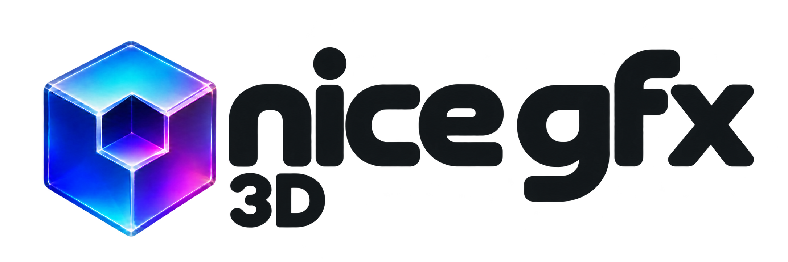

<p align="center">
  
</p>

# NICE_GFX_3D

**English** | [简体中文](README_zh.md)

A C++17 model and animation rendering library for **ESP32-P4 and ESP32-S31**. Its API uses
familiar Three.js concepts: scenes, meshes, cameras, materials, and animation objects.
Devices run native C++. The library does not include game logic, a physics engine, or a
JavaScript interpreter.

Features include model and skeletal animation, software rasterization, dual-core rendering
tasks, image pooling, model caching, lossless storage, and touch controls. It supports both
native C++ projects and Studio exports.

The current version, **0.1.0, is a development release**. APIs and asset formats may still change.
Actual frame rates and memory requirements depend on the model, resolution, materials, UI,
and target board configuration.

Start with **[Animated model players and example guide](examples/README.md)**.

See the [Interaction guide](docs/Interaction.md) for wiring and APIs for one-finger orbiting
and pinch-to-zoom. See [Studio performance and lifecycle](docs/StudioPerformance.md) for
high-performance mode, model controls, and resource cleanup in standard Studio exports.
For a fully editable UI, import the
[NOVA / MOTION LAB project](../nice_gfx_studio/projects/nova-motion-lab-3d/nova-motion-lab-3d.gfx-project.json)
and see its [README](../nice_gfx_studio/projects/nova-motion-lab-3d/README.md).

## License

The library's own code and accompanying offline tools are licensed under [Apache-2.0](LICENSE):
**free for commercial use, including integration into closed-source products, modification,
and redistribution**, with no separate commercial license required. When distributing,
retain the applicable copyright notices, full license text, and [NOTICE](NOTICE), and identify
modifications as required by the license. Third-party models, textures, fonts, SDKs, and other
content remain subject to their own licenses; see the [Third-party index](LICENSES/README.md).

You are welcome to include “This product uses nice gfx” on your website or in product
documentation and link to the [nice gfx project](https://github.com/ailyProject/nice-gfx).
This is an attribution request, not a condition of commercial use. The same rules apply to
chip vendors and developers using their chips.

The separately distributed **AI designer is a paid proprietary product**. Its application,
services, and commercial features are outside this library's Apache license. The library's
own offline tools remain available under the library license; using or distributing the
library does not require purchasing the designer. Versions and code copies previously
licensed under MIT retain their original license; see the
[Historical MIT licensing note](LICENSES/README.md#历史-mit-授权).

## Overview

```text
glTF / GLB → Offline conversion on a computer or in Studio → NG3D model assets
                                                               ↓
Scene → Mesh / SkinnedMesh → Renderer → RGB565 frame
                  ↑                         ↓
            AnimationMixer        nice_gfx display / Studio dynamic image
```

Uploaded models are rendered in real time on the device, rather than converted into GIFs
or prerendered videos.

```cpp
#include <NICE_GFX_3D.h>
using namespace nice_gfx_3d;

Scene scene;
BoxGeometry geometry(1, 1, 1);
MeshLambertMaterial material(Color(0x35aaff)); // Convert 24-bit RGB to RGB565.
Mesh cube(geometry, material);
PerspectiveCamera camera(45, 4.0f / 3.0f, 0.1f, 100);
AmbientLight ambient(0xffff, 0.35f);
DirectionalLight sun(0xffff, 0.8f);
Renderer renderer;

void setup3D() {
  scene.add(cube);
  scene.add(ambient);
  scene.add(sun);
  sun.direction.set(1, -1, -1).normalize();
  camera.position.set(0, 0, 3);
  camera.lookAt(0, 0, 0);
  RendererOptions options;
  options.width = 320;
  options.height = 240;
  // Check the return value before entering the render loop.
  const Status result = renderer.begin(options);
  if (result != Status::Ok) return;
}

Status draw3D(float deltaSeconds) {
  cube.rotation.y += deltaSeconds * 0.8f;
  return renderer.render(scene, camera);
  // After success, renderer.frame() provides pixels / width / height / stride.
}
```

The coordinate system is right-handed, with Y up and the camera facing its local -Z axis.
Euler angles use radians, camera fov uses degrees, and animation time uses seconds.
Geometry triangles use counterclockwise winding when viewed from the front.
`Color(0xRRGGBB)` accepts familiar 24-bit colors; direct integer color arguments use RGB565.
`Clock::getDelta()` provides elapsed time in seconds, and `Renderer::setSize()` explicitly
changes the internal rendering dimensions.

## Installation and output to nice_gfx

Place this library alongside `nice_gfx`. For Arduino, install both libraries. For ESP-IDF,
add both directories to `EXTRA_COMPONENT_DIRS`. The P4 baseline is IDF 5.5.5 or a later
compatible version; S31 requires IDF 6.1 with support for that chip and the corresponding
toolchain. Arduino requires a core with support for the target chip. Use the Flash, PSRAM,
and display settings for your board.

```cpp
#include <Display/FrameAccess.h>
#include <NiceGfxPresenter.h>

NiceGfxPresenter presenter;
// The application has already initialized display for the actual board.
auto* backend = nice_gfx::frameBackend(display);
if (backend) presenter.begin(*backend);

// Each frame, after renderer.render(...) returns Ok:
presenter.presentFit(renderer.frame()); // Preserve aspect ratio, fill the screen, and clear margins to black.
```

`NiceGfxPresenter` takes exclusive ownership of a complete display frame, maps an available
native buffer, and submits it. It uses PPA scaling when the dimensions are suitable;
otherwise, it scales on the CPU using lookup tables and repeated row copies.
Hardware scaling uses bilinear filtering, while the CPU fallback uses nearest-neighbor
sampling, so the visual results differ. PPA's 1/16 scale increments must represent the
target dimensions exactly; otherwise, the CPU path is used.

`presentFit(surface, backgroundColor=0)` preserves aspect ratio and centers the image,
overwrites the entire display each frame, and fills all margins with the specified RGB565
background color. It suits model players that occupy the whole screen.
To preserve other content, use `present(surface, viewport)`. `fit()` only calculates the
destination rectangle; `present(surface, fit(...))` preserves the existing content outside
that rectangle. Omitting the viewport with `present(surface)` stretches the image to fill
the screen. Stretching 320×240 to 1024×600 uses the CPU; `presentFit()` produces a centered
800×600 image, scales both axes by 2.5, can use PPA, and fills the left and right margins.

Only one task may submit frames to a given display object, and submissions must be serial.
Do not call the presenter while the UI has an open frame; it returns `Busy`.
In Studio/UI, use the dynamic image bridge so the UI handles composition and submission.
Tear-free output depends on the backend's atomic frame/VSYNC capabilities; mapping a buffer
alone does not guarantee it.

See [examples/README.md](examples/README.md) for complete examples. ModelFromFlash uses
the Fox model with multiple animation clips, ModelFromLittleFS loads CesiumMan, and
RobotExpressivePlayer demonstrates 14 body animations and crossfading.
esp-idf-model-player is a complete native IDF version. Separate API examples cover scenes,
cameras, materials, textures, and keyframe animation.

The P4 display declaration in the examples targets JC1060P470C_I_W_Y. For other P4 boards,
select the correct preset; do not reuse these display pins on a different board.
S31 examples use Esp32S31Korvo1Display.

## Models and animation

Convert glTF 2.0 / GLB on a computer; the MCU does not parse JSON or decode textures:

```sh
node tools/compile-model.mjs robot.glb -o robot.ng3d
node tools/compile-model.mjs robot.glb -o robot.ng3d --header robot.h --symbol robot_model
```

The generated C++ header can be compiled directly into firmware. NG3D files can also be
loaded from the application's own file system.

```cpp
#include "robot.h"

Model model; // Must outlive mixer.
AnimationMixer mixer;

Status loadModel() {
  Status status = model.load(robot_model, sizeof(robot_model));
  if (status != Status::Ok) return status; // model.error() provides diagnostics.
  scene.add(model.scene());
  if (const auto* clip = model.animation(0)) {
    mixer.clipAction(*clip).setLoop(LoopRepeat).play();
  }
  return Status::Ok;
}

Status animate(float deltaSeconds) {
  mixer.update(deltaSeconds);
  return renderer.render(scene, camera);
}
```

Supported features include position/rotation/scale keyframes, quaternion interpolation,
repeat/once/ping-pong playback, weighted blending of multiple actions, and skeletal skinning
with up to four weights per vertex. `clipAction()` registers actions during initialization;
`update()` does not allocate memory. Destroy the mixer and its actions before clearing or
reloading the model, because actions and bindings borrow the model's clips and nodes.
Stopping playback alone does not release those references.

Loading NG3D copies data into memory owned by the model. After a successful load, the input
file data can be released. `ModelView` is a zero-allocation reader that borrows the source
bytes, which must remain valid while being read. Unsupported import features produce
explicit errors. See [asset-format.md](docs/asset-format.md) for the supported subset and format.

Imported materials default to simple Lambert shading, which requires lights in the scene.
You can adjust the exposed Mesh materials or use your own MeshBasicMaterial for unlit
content. Desktop PBR effects must be baked first.

## Studio

The sibling `nice_gfx_studio` project includes the `gfx-model3d` component, model asset
import, real-time software preview, and a device export bridge. The component is available
only for P4/S31 hardware configurations, and the compiler also validates hardware limits.
Model and clip settings are saved in the project. See
[Studio integration](docs/studio-integration.md) for detailed properties and export instructions.

In the properties panel, explicitly select `dual-core` under “Rendering mode” to enable
supported dual-core rendering, asynchronous clearing, and optional caches.
“Material display” independently selects `source` or `basic`. The default `standard/source`
retains the materials produced by asset conversion. Basic disables runtime lighting and
changes the appearance of Lambert surfaces; performance presets do not select it automatically.

Studio-specific browser import bridges, software preview, and source packaging live in the
`nice_gfx_studio` project. General offline tools, such as model compilation and decoding,
remain in this library's `tools/` directory. Projects containing 3D components package the
library's core source as needed, avoiding duplicate inclusion of the nice_gfx library already
bundled with Studio through a separate library installation. Arduino and ESP-IDF use the same
model bridge.

Before startup and builds, Studio generates and validates
`nice_gfx_studio/public/assets/nice-gfx-3d/runtime.zip` from this library's `src/` directory.
The Studio runtime archive is not stored in this repository. After changing the core source,
you can also run `node scripts/prepare-model3d-runtime.mjs` in the Studio project to update
the archive. This step packages source code; it does not compile or run tests.

## Performance and memory

- Initialization allocates the color buffer, an optional 16-bit depth buffer, and bounded
  vertex/object workspaces.
- Each mesh's vertices are transformed once per frame. Clipping uses fixed-size stack arrays,
  and invisible regular meshes are culled first.
- Scanlines write directly to RGB565; pixel loops do not call nice_gfx's drawPixel or virtual functions.
- Opaque objects are processed front to back, with early rejection of fragments that fail the
  depth test. Transparent objects are sorted back to front by mesh center.
- By default, a reciprocal for perspective correction is calculated once every 8 pixels to
  avoid per-pixel division. Set `perspectiveSpan=1` for per-pixel perspective accuracy;
  supported values are 1–32.
- The bone matrix palette is calculated once per bone per frame; skinned vertices only require
  weighted matrix-vector multiply-add operations.

`maxVertices` is the **vertex capacity of a single primitive**, not the model's total vertex
count. `maxObjects` includes scene objects such as Groups, Meshes, cameras, lights, and bone
nodes; complex models may require larger limits. Exceeding capacity returns
`CapacityExceeded`; rendering does not grow these buffers automatically.
Do not submit a frame if rendering fails.

At 320×240, the color and depth buffers total 300 KiB, excluding vertex and object workspaces.
By default, the color buffer prefers internal SRAM, while depth and workspaces prefer PSRAM.
Use MemoryPreference in RendererOptions to change these preferences. `renderer.stats()` reports
buffer/workspace bytes and draw/task counts; `measurePhases=true` enables coarse phase timings.
See [design.md](docs/design.md) for more capacity estimates.

Memory preferences and `internal` counters do not guarantee placement in main HP DRAM;
the internal heap may also include RTC/LP memory. Repeated freeing and reallocation can
change cache placement. Use `ModelCacheWorkspace` to retain a cache after its first successful
creation: transfer existing buffers with `retainOptimizations(workspace)`, then borrow them
again through optimization overloads that accept a workspace. The workspace retains addresses
without changing the memory class of allocated blocks. See
[Caching across reloads](docs/StaticGeometry.md#跨重载保留缓存) for a small example covering
ownership transfer, leases, 32 typed slots, and failure fallbacks.

For complex models, call `renderer.begin(options)` first to reserve contiguous internal RAM
for workspaces, then call `model.optimizeStaticGeometry()` and `model.optimizeTextures()`.
Avoid filling the internal heap with optional caches first. See [Design and budgeting](docs/design.md)
for native options and failure fallbacks, and the [Static geometry guide](docs/StaticGeometry.md)
for immutability requirements and byte statistics.

Texture caching preserves the original RGB565 pixels. Each 8×8 tile uses a solid color,
an exact palette of up to 16 colors, or a raw tile, depending on its contents; colors are not
quantized. Additional cache memory depends on the content. A 512² texture's ordinary raw
tile payload is 512 KiB; compact caching adds up to 16 KiB of tile metadata, and the compact
layout is retained only when it reduces the total size. Metadata prefers internal RAM,
and payloads use PSRAM. If optional metadata allocation fails, caching falls back to raw
tiles; if overall cache creation fails, the model and existing caches are preserved.
The public `Texture::pixels/stride/sample()` interface still uses the original row layout.

`textureOptimizationBytes()` reports the combined cache payload and tile metadata size;
`textureTilePayloadBytes()` and `textureCompactMetadataBytes()` report them separately.
`renderer.stats().tiledTextureMeshes` and `compactTextureMeshes` reflect actual use in the
current frame. `solidTextureTileCount()` and `paletteTextureTileCount()` report their
respective tile counts. When `textureCompactMetadataInternal()` is true, compact metadata
exists and resides entirely in internal RAM; false can also mean that no compact metadata
is currently in use. Texture pixels must remain unchanged while the cache is active.
After rendering has finished, use `model.clearTextureOptimization()` to release or rebuild
the cache.

Start with an internal rendering resolution of 240×240 or 320×240 and small textures, then
add content gradually. A large display does not require rendering at its native resolution.
PPA, the CPU, and display DMA still share bandwidth.

## Current limitations

The initial release uses nearest-neighbor texture sampling, Basic/Lambert materials,
16-bit depth, and a full-frame color buffer. It does not provide shadows, PBR, postprocessing,
morph targets, CUBICSPLINE, games, or backends for other chips. Transparency is sorted per
mesh and cannot correctly resolve all intersecting transparent surfaces. Double-sided
Lambert shading reuses the vertices' front-face lighting. The browser preview is intended
for composing scenes; its pixel-level output is not guaranteed to match the MCU renderer.

## References and licensing

- [Three.js](https://threejs.org/docs/): Inspires the familiar API organization; this library
  does not implement the full Three.js API.
- [Jet](https://github.com/CubeCoders/Jet): An embedded C++17 software rasterizer for reference.
- [Espressif PPA](https://docs.espressif.com/projects/esp-idf/en/latest/esp32p4/api-reference/peripherals/ppa.html):
  Output scaling capabilities and limitations.

This library is an independent implementation and does not bundle Three.js, Jet, or Quake
engine source code. Its own code is licensed under Apache-2.0; nice_gfx and user-imported
models are subject to their respective licenses.
