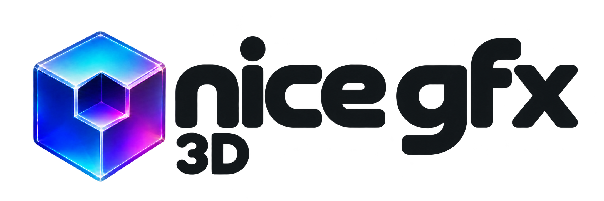

<p align="center">
  
</p>

# NICE_GFX_3D

[English](README.md) | **简体中文**

面向 **ESP32-P4、ESP32-S31** 的 C++17 模型与动画显示库。接口采用
Three.js 熟悉的场景、网格、相机、材质和动画对象；设备运行原生 C++。
本库不包含游戏规则、物理引擎或 JavaScript 解释器。

支持模型与骨骼动画、软件光栅化、双核渲染任务、图像池、模型缓存、无损存储和触摸控制，
可用于原生 C++ 工程及 Studio 导出。

当前版本 **0.1.0 为开发版本**，API 和资源格式仍可能调整。
实际帧率与内存需求取决于模型、分辨率、材质、UI 和目标板配置。

优先查看 **[真实动画播放器与示例导航](examples/README.md)**。

单指绕模型旋转、双指缩放的接线与 API 见 [交互指南](docs/Interaction.md)。
普通 Studio 导出的高性能模式、模型控制和资源回收见 [Studio 性能与生命周期](docs/StudioPerformance.md)。
完整可编辑 UI 可导入 [NOVA / MOTION LAB 项目](../nice_gfx_studio/projects/nova-motion-lab-3d/nova-motion-lab-3d.gfx-project.json)，
项目说明见其 [README](../nice_gfx_studio/projects/nova-motion-lab-3d/README.md)。

## 使用许可

本库自有代码及配套离线工具采用 [Apache-2.0](LICENSE)：**免费商用，可闭源集成、修改和分发**，无需申请商用许可。分发时请按许可保留相关版权、许可全文与 [NOTICE](NOTICE)，并标明修改；模型、贴图、字体、SDK 等第三方内容继续遵守各自许可，见[第三方索引](LICENSES/README.md)。

欢迎在官网或产品说明中注明“本产品使用 nice gfx”并链接 [nice gfx 项目](https://github.com/ailyProject/nice-gfx)；这是推广倡议，不是获得商用授权的条件，芯片厂商和使用其芯片的开发者均适用相同规则。

独立发布的 **AI 设计器是收费专有产品**，其应用、服务和商业功能不在本库 Apache 授权范围内。本库自有离线工具仍按本库许可提供；使用或分发本库不要求购买设计器。历史已按 MIT 授出的版本和代码副本仍保留原授权，见[历史 MIT 说明](LICENSES/README.md#历史-mit-授权)。

## 快速理解

```text
glTF / GLB → 电脑或 Studio 离线转换 → NG3D 模型资源
                                          ↓
Scene → Mesh / SkinnedMesh → Renderer → RGB565 帧
                  ↑                        ↓
            AnimationMixer        nice_gfx 显示 / Studio 动态图像
```

模型上传后由设备实时渲染，不转换为 GIF 或预渲染视频。

```cpp
#include <NICE_GFX_3D.h>
using namespace nice_gfx_3d;

Scene scene;
BoxGeometry geometry(1, 1, 1);
MeshLambertMaterial material(Color(0x35aaff)); // 24-bit RGB 转换为 RGB565
Mesh cube(geometry, material);
PerspectiveCamera camera(45, 4.0f / 3.0f, 0.1f, 100);
AmbientLight ambient(0xffff, 0.35f);
DirectionalLight sun(0xffff, 0.8f);
Renderer renderer;

void setup3D() {
  scene.add(cube);
  scene.add(ambient);
  scene.add(sun);
  sun.direction.set(1, -1, -1).normalize();
  camera.position.set(0, 0, 3);
  camera.lookAt(0, 0, 0);
  RendererOptions options;
  options.width = 320;
  options.height = 240;
  // 检查返回值后才进入绘制循环。
  const Status result = renderer.begin(options);
  if (result != Status::Ok) return;
}

Status draw3D(float deltaSeconds) {
  cube.rotation.y += deltaSeconds * 0.8f;
  return renderer.render(scene, camera);
  // 成功后 renderer.frame() 提供 pixels / width / height / stride。
}
```

右手坐标系、Y 向上、相机朝局部 -Z；欧拉角使用弧度，相机 fov 使用角度，
动画时间使用秒。几何三角形按从正面观察的逆时针顺序排列。
`Color(0xRRGGBB)` 支持熟悉的 24-bit 颜色，直接整数参数则是 RGB565。
`Clock::getDelta()` 可以提供动画秒数；`Renderer::setSize()` 显式调整内部尺寸。

## 安装与输出到 nice_gfx

本库与 `nice_gfx` 同级。Arduino 安装两个库，ESP-IDF 将两个目录加入
`EXTRA_COMPONENT_DIRS`。P4 以 IDF 5.5.5 或后续兼容版本为基线，S31 需要
支持该芯片的 IDF 6.1 及对应工具链。Arduino 必须使用带对应芯片支持的 core。
使用开发板自己的 Flash、PSRAM 和显示配置。

```cpp
#include <Display/FrameAccess.h>
#include <NiceGfxPresenter.h>

NiceGfxPresenter presenter;
// display 已由应用按实际板卡初始化。
auto* backend = nice_gfx::frameBackend(display);
if (backend) presenter.begin(*backend);

// 每帧，在 renderer.render(...) 返回 Ok 后：
presenter.presentFit(renderer.frame()); // 保持比例，整屏写入并将留边填黑。
```

`NiceGfxPresenter` 独占一次完整显示帧，映射可用的原生缓冲并提交，
合适的尺寸使用 PPA 缩放；PPA 不适用时使用查表和重复行复制的 CPU 缩放。
硬件缩放使用双线性，CPU 回退使用最近邻，视觉结果会有区别。
PPA 的 1/16 缩放步长必须能精确表示目标尺寸，否则走 CPU 路径。
`presentFit(surface, backgroundColor=0)` 保持宽高比并居中，每帧覆盖整个显示器，
图像外全部留边填入指定 RGB565 背景色；适合独占屏幕的模型播放器。
需要保留其他内容时用 `present(surface, viewport)`；`fit()` 仅计算目标矩形，
`present(surface, fit(...))` 会保留矩形外原画面。`present(surface)` 省略 viewport
会拉伸填满屏幕。320×240 拉伸到 1024×600 会走 CPU；`presentFit()` 得到
居中的 800×600，两个方向 2.5 倍，可走 PPA，并真实填入左右留边。

同一显示对象只能由一个任务串行提交。不要在 UI 已打开帧时调用 presenter；
它会返回 `Busy`。在 Studio/UI 中使用动态图像桥接，由 UI 统一合成和提交。
后端的原子帧/VSYNC 能力决定是否无撕裂，映射缓冲本身不保证无撕裂。

完整例子见 [examples/README.md](examples/README.md)。其中 ModelFromFlash 使用
真实 Fox 多动作，ModelFromLittleFS 加载 CesiumMan，RobotExpressivePlayer
展示 14 个身体动作及交叉混合；esp-idf-model-player 是完整原生 IDF 版本。
场景、相机、材质、贴图和关键帧另有独立 API 专题。

示例 P4 显示声明对应 JC1060P470C_I_W_Y。其他 P4 板卡请替换为正确预设；
不要将显示引脚套用到其他板卡。S31 示例使用 Esp32S31Korvo1Display。

## 模型与动画

电脑端转换 glTF 2.0 / GLB，不在 MCU 上解析 JSON 或解码纹理：

```sh
node tools/compile-model.mjs robot.glb -o robot.ng3d
node tools/compile-model.mjs robot.glb -o robot.ng3d --header robot.h --symbol robot_model
```

生成的 C++ 头可以直接编入固件；NG3D 文件也可以从应用自己的文件系统读取。

```cpp
#include "robot.h"

Model model; // 比 mixer 活得更久
AnimationMixer mixer;

Status loadModel() {
  Status status = model.load(robot_model, sizeof(robot_model));
  if (status != Status::Ok) return status; // model.error() 提供诊断
  scene.add(model.scene());
  if (const auto* clip = model.animation(0)) {
    mixer.clipAction(*clip).setLoop(LoopRepeat).play();
  }
  return Status::Ok;
}

Status animate(float deltaSeconds) {
  mixer.update(deltaSeconds);
  return renderer.render(scene, camera);
}
```

支持位置/旋转/缩放关键帧、四元数插值、重复/单次/往返播放、多个动作权重混合，
以及每顶点最多四权重的骨骼蒙皮。`clipAction()` 在初始化时注册动作，
`update()` 不分配内存。销毁 mixer 及其 actions 后再清空/重新加载 model，
因为动作和绑定借用模型的 clip 与节点；仅停止播放不会解除这些引用。

NG3D 加载会复制为模型拥有的内存，成功后可释放输入文件数据。
`ModelView` 则是零分配的借用式读取器，源字节必须在读取期间有效。
不支持的导入特性会返回明确错误。当前子集与格式见 [asset-format.md](docs/asset-format.md)。

默认导入材质为简单 Lambert，需要在场景添加光照；可调整公开的 Mesh 材质，
或用自己的 MeshBasicMaterial 显示不受光照影响的内容。桌面 PBR 效果需要先烘焙。

## Studio

同级 `nice_gfx_studio` 已加入 `gfx-model3d` 组件、模型资产导入、实时软件预览
和设备导出桥接。仅 P4/S31 硬件配置显示该组件，编译器也校验硬件限制。
模型和 clip 配置保存在项目中。详细属性和导出方式见
[Studio integration](docs/studio-integration.md)。

属性栏的“渲染方式”可显式选择 `dual-core`，启用受支持的双核、异步清屏与可选缓存；
“材质显示”独立选择 `source` 或 `basic`。默认 `standard/source` 保留资源转换后的材质。
Basic 关闭运行时灯光，会改变 Lambert 表面的外观，不由性能预设自动选择。

Studio 专用的浏览器导入桥接、软件预览和源码打包流程位于 `nice_gfx_studio`
项目中；模型编译、解码等通用离线工具保留在本库的 `tools/`。
含 3D 组件的工程按需打包本库核心源码，避免额外安装库时重复引入
Studio 已携带的 nice_gfx。Arduino 和 ESP-IDF 使用相同的模型桥接。

Studio 启动、构建前从本库 `src/` 生成并校验
`nice_gfx_studio/public/assets/nice-gfx-3d/runtime.zip`，本库不保存 Studio 运行包。
修改核心源码后，也可在 Studio 项目中运行 `node scripts/prepare-model3d-runtime.mjs`
更新运行包。这是源码打包步骤，不执行编译或测试。

## 性能与内存

- 初始化时分配颜色缓冲、可选 16-bit 深度缓冲和有上限的顶点/对象工作区。
- 每个网格的顶点每帧变换一次，裁剪使用固定栈数组；先剔除不可见普通网格。
- 扫描线直接写 RGB565，不在像素循环调用 nice_gfx 的 drawPixel 或虚函数。
- 不透明物体从近到远，深度失败的片元提前退出；透明物体按网格中心远到近。
- 默认每 8 个像素做一次透视校正倒数，避免每像素除法。`perspectiveSpan=1`
  可选逐像素透视精度；支持 1～32。
- 骨骼调色板每帧每骨计算一次，蒙皮顶点只做权重矩阵向量乘加。

`maxVertices` 是**单个 primitive 的顶点容量**，不是模型总顶点数。
`maxObjects` 包括 Group、Mesh、相机/灯光及骨骼节点等场景对象；复杂模型需要调整。
超出容量返回 `CapacityExceeded`，不会在 render 中自动扩容。
渲染失败时不要提交本帧。

320×240 的颜色与深度缓冲合计 300 KiB，顶点与对象工作区另计。
默认颜色优先内部 SRAM，深度和工作区优先 PSRAM；可以通过 RendererOptions
改变 MemoryPreference。`renderer.stats()` 提供缓冲/工作区字节、绘制与任务计数；
`measurePhases=true` 时提供粗粒度阶段耗时。
更多容量预算见 [design.md](docs/design.md)。

内存偏好与 `internal` 计数均不保证主 HP DRAM：内部堆也可能包含 RTC/LP 内存。
重复释放再分配可能改变缓存位置。可用 `ModelCacheWorkspace` 保留首次成功建立的缓存，
通过 `retainOptimizations(workspace)` 接管已有缓冲，再用带工作区的优化重载重新借用；
工作区只保留地址，不改变已分配块的内存类别。接管、租约、32 个类型槽及失败回退的
小示例见 [跨重载缓存](docs/StaticGeometry.md#跨重载保留缓存)。

较复杂模型建议先用 `renderer.begin(options)` 给工作区留出连续内部 RAM，再调用
`model.optimizeStaticGeometry()`、`model.optimizeTextures()`，不要先让可选缓存占满内部堆。
原生选项与失败回退见 [设计与预算](docs/design.md)；静态几何的不可变约定和字节统计见
[静态几何指南](docs/StaticGeometry.md)。

纹理缓存保持原 RGB565 像素：每个 8×8 块按内容选择固色、最多 16 色的精确调色板或
原始块，未做颜色量化。缓存额外占用取决于内容；512² 的普通原始块载荷为 512 KiB，
紧凑缓存另有最多 16 KiB 块元数据，只有节省总量时才保留紧凑布局。
元数据优先内部 RAM，载荷使用 PSRAM。可选元数据失败退回原始块；整体缓存建立失败
保留模型和已有缓存。公开的 `Texture::pixels/stride/sample()` 仍使用原始行排列。
`textureOptimizationBytes()` 报告缓存载荷与块元数据合计，
`textureTilePayloadBytes()`、`textureCompactMetadataBytes()` 可分开查看；
`renderer.stats().tiledTextureMeshes` 与 `compactTextureMeshes` 反映本帧实际使用情况。
`solidTextureTileCount()`、`paletteTextureTileCount()` 给出对应块数；
`textureCompactMetadataInternal()` 为 true 表示存在紧凑元数据且全部位于内部 RAM，
false 也可能表示当前没有使用紧凑元数据。
纹理像素在缓存生效期间必须保持不变；等待渲染结束后可用
`model.clearTextureOptimization()` 释放或重建缓存。

初始建议使用 240×240 或 320×240 内部渲染和小尺寸纹理，逐步增加内容。
显示大屏不等于按大屏原生分辨率渲染。PPA、CPU、显示 DMA 仍会共享带宽。

## 当前边界

首版采用最近邻纹理、Basic/Lambert 材质、16-bit 深度和整帧颜色缓冲。
不提供阴影、PBR、后处理、morph target、CUBICSPLINE、游戏或其他芯片后端。
透明按网格排序，不能正确解决所有相交透明面；双面 Lambert 沿用顶点正面光照。
浏览器预览用于编辑构图，其逐像素结果与 MCU 渲染器不保证相同。

## 参考与许可证

- [Three.js](https://threejs.org/docs/)：借鉴开发者熟悉的 API 组织方式，未实现全部 Three.js API。
- [Jet](https://github.com/CubeCoders/Jet)：可参考的嵌入式 C++17 软件光栅器。
- [Espressif PPA](https://docs.espressif.com/projects/esp-idf/en/latest/esp32p4/api-reference/peripherals/ppa.html)：输出缩放能力与限制。

当前库是独立实现，未内置 Three.js、Jet 或 Quake 引擎源码。自有代码采用 Apache-2.0；
nice_gfx 与用户导入模型的许可证分别适用。
