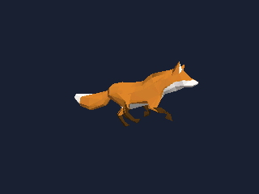

# Flash 模型加载：Fox 三种真实骨骼动作

默认绘制调度间隔为 16ms；实际帧率取决于渲染、显示提交和触摸读取。
输入配置与 UI 共用触摸见 [Interaction.md](../../docs/Interaction.md)。

本例独占整屏，使用 `presenter.presentFit(renderer.frame())` 保持比例，
每帧覆盖整个屏幕并把全部留边填黑；第二个参数可指定 RGB565 背景色。
需要保留外围内容时使用 `present(surface, viewport)`，不要使用整屏填边 API。

单指拖动绕狐狸整体中心观察，双指捏合缩放；串口 `h` 恢复初始相机。
动作播放、暂停、倍速和切换都保留手动视角。中心与缩放边界来自资源的尺寸数据，
触摸在帧门限之前读取。启动 `Orbit touch probe: ready/unavailable` 日志报告探测结果。
默认使用 P4 JC1060 GT911 / S31 Korvo GT1151；换板时同步调整 `NiceGfxOrbitInput` 配置。

直接打开 `ModelFromFlash.ino`。模型、纹理、骨骼与三个动作已转换在本文件夹的
`FoxModel.h` 中，无需先运行电脑工具，也不需要文件系统。它来自 Khronos 官方
glTF 样例 [Fox](https://github.com/KhronosGroup/glTF-Sample-Assets/tree/8f492390ddc7a2ae221a1369ef560589cf8c70fb/Models/Fox)。

这是一只带真实关节蒙皮的低多边形狐狸：1728 顶点、576 三角形、24 个骨骼，
NG3D 资源 299624 字节。动作是 Survey、Walk、Run；没有把动作替换成整体旋转，
没有删除骨骼、权重或原动画通道。



上图由桌面原生 `Model` / `Renderer` 加载资源生成，展示 Run 动作的一帧。

## 板卡和运行

1. 安装 `nice_gfx` 与 `nice_gfx_3d` 两个 Arduino 库，使用支持目标芯片的 Arduino core。
   P4 需要与 IDF 5.5.5 或后续兼容版本匹配的 core；S31 需要带该芯片支持的 IDF 6.1 系列 core。
2. 打开本文件夹中的 `.ino`，选择真实板卡、Flash 容量及 PSRAM 配置，并启用板载 PSRAM。
3. `Hardware.h` 自动选择 P4 的 `Jc1060P470CIWYDisplay` 或 S31 的
   `Esp32S31Korvo1Display`。使用其他屏幕时替换显示预设，不要照搬这些引脚。
4. 上传程序，打开 115200 波特率串口。相机已根据资源的绑定姿态尺寸配置。

启动后每 8 秒切换一次动作。串口控制：

| 输入 | 操作 |
| --- | --- |
| `1` / `2` / `3` | 播放 Survey / Walk / Run，停止自动切换 |
| `a` | 恢复自动切换 |
| `p` | 暂停或继续当前动作 |
| `+` / `-` | 调整播放速度，0.25～2 倍 |

`AnimationMixer::clipAction()` 仅在初始化时注册三个动作；切换时停止旧动作，
初始化另保存各资产节点的原始 TRS，每帧先恢复再采样动作，避免上一个动作未被新动作
覆盖的通道残留；不改外层模型容器或相机。循环复用这些数组，不逐帧分配。
每次渲染后主动让出 CPU，显示后端暂时 `Busy` 时继续重试。
默认内部渲染 320×240，再等比例放大到屏幕。
`maxVertices` 来自该资产单个 primitive 的顶点数，`maxObjects` 包含骨骼节点的预算。
串口报告实际运行时的 render/present 耗时和 PPA/CPU 输出路径；16ms 是调度门限，
不是帧率承诺。内存不足可将内部尺寸改为 240×180，并保持相机宽高比为 4:3。

`Model::load` 会深拷贝资源；`FoxModel.h` 中的常量保留在固件只读数据区。
载入后的几何、纹理、骨骼和关键帧仍占运行内存。模型必须比 mixer/action 活得更久，
播放过程中不要 `clear()` 或重新加载。内存分配是否进入 PSRAM 取决于所用 core 的堆配置。

## 资源与再生成

- `FoxModel.h`：本例实际使用的 NG3D C++ 数组。
- `AssetInfo.h`：相机中心、半径、渲染容量，随资源生成。
- `../assets/Fox.ng3d`：供文件系统方案复用的共享二进制资源。
- `ASSET_METADATA.json`：来源 commit、SHA256、数量、动作时长及适配记录。
- `CREDITS.md`、`UPSTREAM_*`、`licenses/`：模型署名和许可。

在 `nice_gfx_3d` 目录执行资源制作命令：

```sh
node examples/assets/prepare-khronos-models.mjs
```

它重新使用已留存的原模型，缺少文件时才从固定提交下载；纹理最大边缩至 256 像素，
生成 PNG、可直接导入 Studio 的 `examples/assets/Fox.gltf`、NG3D 与本例数组。
Windows 使用系统自带的 System.Drawing；其他系统需要 Python 3 与 Pillow。
