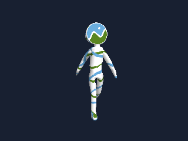

# LittleFS 模型加载：CesiumMan 真实人形骨骼动作

默认绘制调度间隔为 16ms；实际帧率取决于渲染、显示提交和触摸读取。
输入配置与 UI 共用触摸见 [Interaction.md](../../docs/Interaction.md)。

本例独占整屏，使用 `presenter.presentFit(renderer.frame())` 保持比例，
每帧覆盖整个屏幕并把全部留边填黑；第二个参数可指定 RGB565 背景色。
需要保留外围内容时使用 `present(surface, viewport)`，不要使用整屏填边 API。

单指拖动绕整个人物中心观察，双指捏合缩放，串口 `h` 复位相机；`r` 仍重播动作。
控制目标使用 `AssetInfo.h` 的模型中心，距离限制为近远裁剪面留出余量。
触摸在帧门限之前读取，启动 `Orbit touch probe: ready/unavailable` 日志显示探测状态。
默认配置对应 P4 JC1060 GT911 / S31 Korvo GT1151；换板时也需调整 `NiceGfxOrbitInput`。

打开 `ModelFromLittleFS.ino`，将本文件夹的 `data/` 上传到板上的 LittleFS。
模型为 Khronos 官方样例 [Cesium Man](https://github.com/KhronosGroup/glTF-Sample-Assets/tree/8f492390ddc7a2ae221a1369ef560589cf8c70fb/Models/CesiumMan)：
3273 顶点、4672 三角形、19 个骨骼，保留原有 2 秒循环人形动作。
NG3D 文件为 435740 字节；本例实际从文件读取它，不从头文件取模型。



上图由桌面原生 `Model` / `Renderer` 加载资源生成，展示骨骼动画的一帧。

## 板卡与文件系统

1. 安装 `nice_gfx`、`nice_gfx_3d`，选择支持 P4/S31 的 Arduino core、实际板卡、
   Flash 容量和 PSRAM 类型，并启用 PSRAM。P4 以兼容 IDF 5.5.5 的 core 为基线，
   S31 使用带该芯片支持的 IDF 6.1 系列 core。
2. 选择同时容纳程序和文件系统的分区方案；文件系统空间建议至少 1MiB。
   固件与文件系统上传时必须保持相同 Flash 容量及分区配置。
3. 本例自带 `data/CesiumMan.ng3d`。使用与你的 Arduino core、IDE 版本匹配的
   文件系统上传工具，选择 **LittleFS** 格式，把整个 `data/` 目录写入对应分区。
   上传前关闭串口监视器；使用已有上传流程即可，无需把 NG3D 改名为其他格式。
4. 上传 `.ino`，打开 115200 波特率串口。若你的工具要求相反上传顺序也可，
   但之后不要执行清空整个 Flash 的操作，以免擦掉已写入的数据分区。

成功后设备根目录应存在 `/CesiumMan.ng3d`。程序使用 `LittleFS.begin(false)`，
挂载失败不会自动格式化。若提示挂载失败，确认工具写入的是 LittleFS、分区标签/
偏移与当前 core 一致；提示找不到模型时确认上传的是本例的 `data` 文件夹。

`Hardware.h` 自动使用 P4 的 `Jc1060P470CIWYDisplay` 或 S31 的
`Esp32S31Korvo1Display`。其他屏幕请替换正确的 nice_gfx 预设。

## 读取与播放

程序限制输入文件不超过 2MiB，优先把完整文件读入 PSRAM，失败才尝试内部堆，
并处理短读、文件丢失和分配失败。`Model::load` 成功后持有自己的资源，
因此立即释放输入数组并卸载 LittleFS，播放时不再访问文件系统。
加载过程的临时输入数组和模型内存会同时存在，需预留额外空间。
后续 STL 分配进入哪个堆仍取决于 Arduino core 的 PSRAM 配置。

串口操作：

| 输入 | 操作 |
| --- | --- |
| `p` | 暂停或继续 |
| `r` | 从头播放 |
| `+` / `-` | 0.25～2 倍速 |

默认内部渲染 320×240，按绑定姿态的包围范围配置相机，使用
`AnimationMixer` 循环播放 `animation_0`。该名字由转换器为原模型未命名的动作生成。
串口输出运行时帧率、render/present 耗时及 PPA/CPU 路径，16ms 只是调度门限。
每次渲染后主动让出 CPU，显示后端暂时 `Busy` 时继续重试。
需要降低负载时可改为 240×180；本例未承诺任何板端帧率。

## 文件说明

- `data/CesiumMan.ng3d`：本例实际读取的完整模型。
- `AssetInfo.h`：容量和相机元数据。
- `ASSET_METADATA.json`：来源、SHA256、数量、动作及适配记录。
- `CREDITS.md`、`UPSTREAM_*`、`licenses/`：作者和完整许可说明。

共享原始 GLB、固定提交及可导入 Studio 的 `CesiumMan.gltf` 在
`../assets/`。重新制作素材可在 `nice_gfx_3d` 目录运行：

```sh
node examples/assets/prepare-khronos-models.mjs
```

需要改成 Flash 加载时，可用 `node tools/compile-model.mjs examples/assets/CesiumMan.gltf -o CesiumMan.ng3d --header CesiumManModel.h --symbol kCesiumManModel` 生成嵌入数组。

纹理由原 JPEG 缩至最大边 256 像素并转为 PNG/RGB565；骨骼、权重和动画通道保留。
